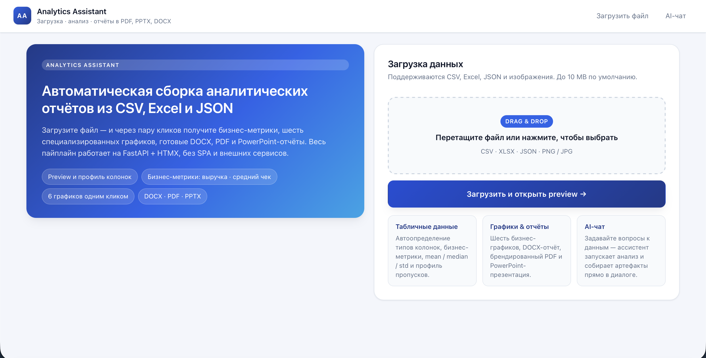
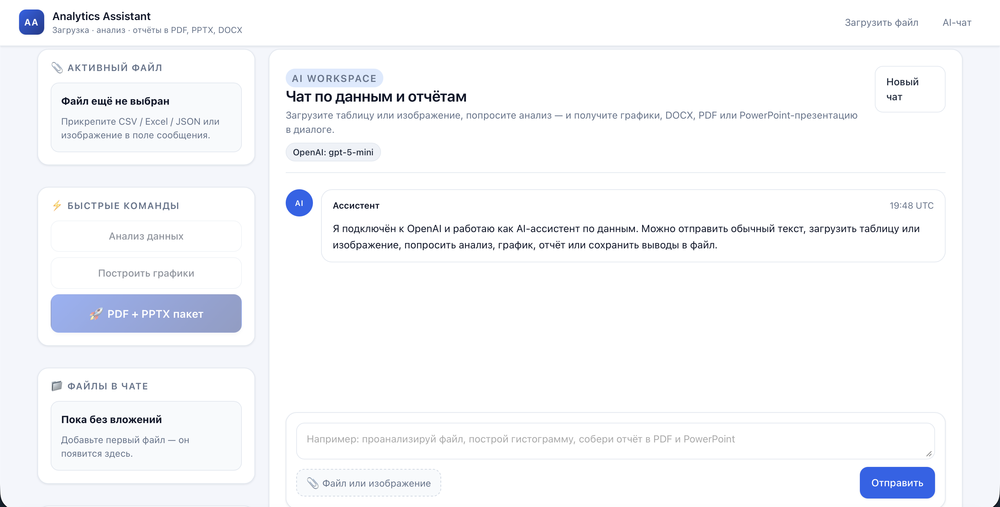
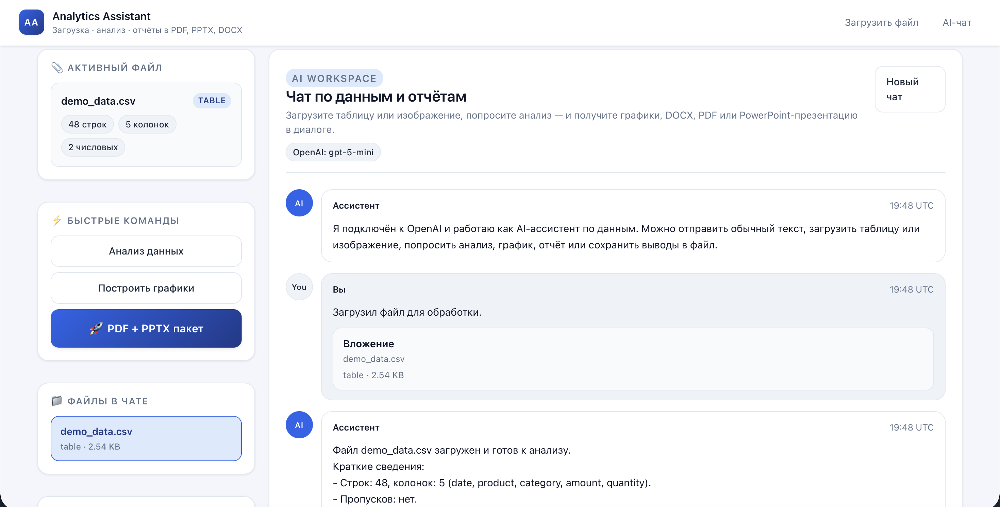
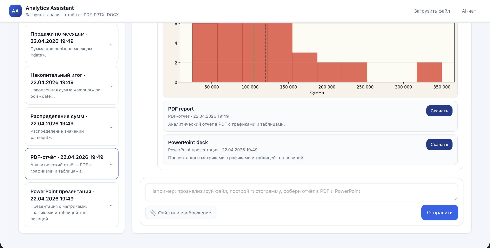

# Analytics Assistant: auto-generated reports and an AI chat over your data

A web app that turns a table or an image into a finished analytical report: a set of charts, a Word document, a PDF and a PowerPoint deck. You can work with buttons or by typing in an AI chat.

This is a practice project. The interface works in Russian and English. Live demo: [analytics.tatidzufri.com](https://analytics.tatidzufri.com). Case study: [tatidzufri.com/en/case/business-reports](https://tatidzufri.com/en/case/business-reports).


## About the project

The user uploads a file, and the app works out which columns it has (date, amount, category, quantity), computes metrics, draws charts and builds reports in three formats at once. For a non-standard task you can type a request in the chat in plain words, and the assistant picks the actions itself.

## The task

An analyst, a marketer or a business owner often has raw exports: sales from 1C (a Russian accounting system), Amazon reports, CRM data. To show them to management or a client, you have to compute metrics (revenue, average order, top items), draw charts and put it all into a neat document.

It's especially awkward when people need different formats: Word for one, PDF for another, slides for management.

## How it works

1. **Upload.** A CSV, Excel, JSON file or an image up to 10 MB is dragged into the upload area.
2. **One-click analysis.** Row and column counts, data types, gaps and business metrics: total, average order, number of records, top items.
3. **Charts.** Six business charts for sales tables (daily trend, top items, quantity by day, sales by month, running total, amount distribution) and three basic ones for any table.
4. **Reports in three formats.** Word with metrics, column descriptions and charts. A branded PDF with a title page and tables. PowerPoint with a slide per metric and chart. Download them one by one or as a bundle.
5. **AI chat.** Requests like "build a full business report in PDF and PowerPoint" are turned by the model into commands the server runs: draw a chart, build a document, save the conclusions. The conversation summary is saved as Markdown.
6. **Works without a key.** If no OpenAI key is set, the chat parses commands by marker words, and every button in the interface keeps working.

Files get readable names, for example "Sales trend · 22.04.2026 19:47", and times in reports follow the local time zone.

## What it looks like

**Home page** with the upload form.



**Charts** with captions and a "Download" button.


**AI chat.** An empty chat, the summary after a file upload, a chart right in the conversation, and finished PDF and PowerPoint files with download links.

| Empty chat | File uploaded |
|:-:|:-:|
|  |  |
| **Chart in the conversation** | **Reports ready** |
|  |  |

Sample reports: [demo_report.pdf](demo/examples/demo_report.pdf), [demo_report.docx](demo/examples/demo_report.docx), [demo_presentation.pptx](demo/examples/demo_presentation.pptx).

## Results

- Reports are built automatically in the format you need.
- You can work with the data through the chat, without an analyst.
- Charts are drawn automatically, with no manual setup.

## Tech stack

| Technology | What it's for |
|---|---|
| **Python 3.11** | Data analysis, charts, building documents |
| **FastAPI + Uvicorn** | The server: file uploads, pages, user actions, AI requests |
| **Jinja2 + HTMX** | Interface pages and the PDF template. HTMX updates parts of the page without a reload |
| **Pandas, NumPy, openpyxl** | Reading CSV, Excel and JSON, metrics, column types, grouping |
| **Pillow** | Handling an image uploaded instead of a table |
| **Matplotlib** | All nine chart types as PNG |
| **python-docx** | The Word report |
| **WeasyPrint** | PDF from an HTML template with CSS |
| **python-pptx** | The PowerPoint deck |
| **OpenAI API** | The natural-language chat. The model is set in `.env`, `gpt-5-mini` by default |
| **Docker Compose** | Runs with all the system libraries PDF needs |

## Repository structure

- `app/`: the server. Settings, page and action routes, services for files, analysis, charts, reports, chat and AI.
- `templates/`: interface pages and the PDF template.
- `static/`: interface styles and scripts.
- `demo/`: demo data (`demo_data.csv`, `demo_data.json`, an Amazon-style export), screenshots and sample reports in `demo/examples/`.

## Running it

With Docker:

```bash
cp .env.example .env          # OpenAI key optional
docker compose up --build     # http://localhost:8000
```

Locally you need Python 3.11 and WeasyPrint's system libraries (Pango, via Homebrew or apt):

```bash
python3.11 -m venv .venv && source .venv/bin/activate
pip install -r requirements.txt
cp .env.example .env
uvicorn app.main:app --port 8000
```

Upload `demo/demo_data.csv` and press "Run analysis", or type "build a business pack" in the chat.

## Roadmap

- Emailing finished reports on a schedule.
- A local model (Ollama, llama.cpp) instead of OpenAI.
- Loading data straight from databases (PostgreSQL, ClickHouse) without exporting to a file.

## Author

Tetiana Dziubas, AI automation engineer. I build Telegram bots, RAG assistants and LLM agents that take routine work off small teams. Case studies and contact: [tatidzufri.com/en](https://tatidzufri.com/en/).
