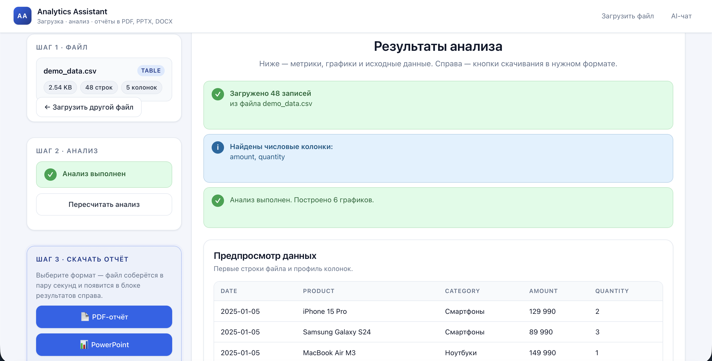
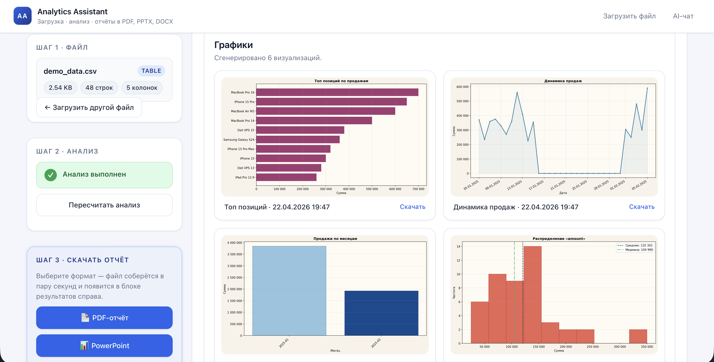
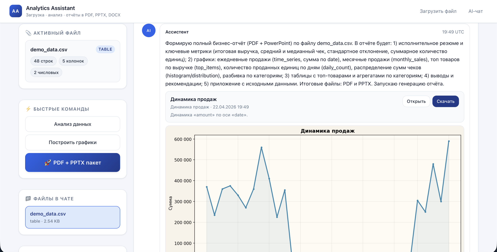

# Analytics Assistant: AI-помощник для аналитических отчетов

Веб-приложение превращает таблицу или картинку в готовый аналитический отчет: набор графиков, документ Word, PDF и презентацию PowerPoint. Работать можно кнопками или текстом в AI-чате на русском языке. (учебный проект)



## О проекте

Пользователь загружает файл, приложение само определяет, какие в нем колонки (дата, сумма, категория, количество), считает метрики, строит графики и собирает отчеты сразу в трех форматах. Для нестандартной задачи можно написать запрос в чат обычными словами, и помощник сам выберет нужные действия.

## Задача

У аналитика, маркетолога или предпринимателя часто есть сырые выгрузки: продажи из 1С, отчеты Amazon, данные CRM. Чтобы показать их руководству или клиенту, нужно посчитать метрики (выручку, средний чек, топ позиций), построить графики и собрать все в аккуратный документ.

Вручную на это уходит от получаса до нескольких часов. Особенно неудобно, когда формат нужен разный: кому-то Word, кому-то PDF, а руководству слайды.

## Решение

1. **Загрузка.** CSV, Excel, JSON или картинка размером до 10 МБ перетаскиваются в зону загрузки.
2. **Анализ в один клик.** Число строк и колонок, типы данных, пропуски и бизнес-метрики: сумма, средний чек, количество записей, топ позиций.
3. **Графики.** Шесть бизнес-графиков для таблиц с продажами (динамика по дням, топ позиций, количество по дням, продажи по месяцам, накопительный итог, распределение сумм) и три базовых для любых таблиц.
4. **Отчеты в трех форматах.** Word с метриками, описанием колонок и графиками. PDF в фирменном оформлении с титулом и таблицами. PowerPoint со слайдом под каждую метрику и график. Можно скачать по отдельности или пакетом.
5. **AI-чат.** Запросы вроде «собери полный бизнес-отчет в PDF и PowerPoint» модель превращает в команды, которые выполняет сервер: построить график, собрать документ, сохранить выводы. Итог беседы сохраняется в Markdown.
6. **Работа без ключа.** Если ключ OpenAI не задан, чат разбирает команды по словам-маркерам, а все кнопки интерфейса продолжают работать.

Файлы получают понятные названия, например «Динамика продаж · 22.04.2026 19:47», время в отчетах указано по местному часовому поясу.

## Как это выглядит

**Главная страница** с формой загрузки.


**Графики** с подписями и кнопкой «Скачать».



**AI-чат.** Пустой чат, сводка после загрузки файла, график прямо в диалоге и готовые PDF и PowerPoint со ссылками на скачивание.

| Пустой чат | Файл загружен |
|:-:|:-:|
|  |  |
| **График в диалоге** | **Отчеты готовы** |
|  |  |

Примеры готовых отчетов: [demo_report.pdf](demo/examples/demo_report.pdf), [demo_report.docx](demo/examples/demo_report.docx), [demo_presentation.pptx](demo/examples/demo_presentation.pptx).

## Результат

- Отчеты собираются автоматически в нужном формате.
- С данными можно работать через чат, без аналитика.
- Графики строятся сами, настраивать их вручную не нужно.
- На демо-данных полный комплект (шесть графиков, PDF и PowerPoint) готов через несколько секунд после загрузки.

## Стек технологий

| Технология | Зачем используется |
|---|---|
| **Python 3.11** | Анализ данных, графики, сборка документов |
| **FastAPI + Uvicorn** | Сервер: загрузка файлов, страницы, действия пользователя, запросы к AI |
| **Jinja2 + HTMX** | Страницы интерфейса и шаблон PDF. HTMX обновляет части страницы без перезагрузки |
| **Pandas, NumPy, openpyxl** | Чтение CSV, Excel и JSON, метрики, типы колонок, группировки |
| **Pillow** | Работа с картинками, если загружена картинка вместо таблицы |
| **Matplotlib** | Все девять видов графиков в PNG |
| **python-docx** | Отчет Word |
| **WeasyPrint** | PDF из HTML-шаблона с CSS |
| **python-pptx** | Презентация PowerPoint |
| **OpenAI API** | Чат на естественном языке. Модель задается в `.env`, по умолчанию `gpt-5-mini` |
| **Docker Compose** | Запуск со всеми системными библиотеками для PDF |

## Структура репозитория

- `app/`: сервер. Настройки, маршруты страниц и действий, сервисы для файлов, анализа, графиков, отчетов, чата и AI.
- `templates/`: страницы интерфейса и шаблон PDF.
- `static/`: стили и скрипты интерфейса.
- `demo/`: демо-данные (`demo_data.csv`, `demo_data.json`, выгрузка в стиле Amazon), скриншоты и примеры отчетов в `demo/examples/`.

## Запуск

Через Docker:

```bash
cp .env.example .env          # ключ OpenAI по желанию
docker compose up --build     # http://localhost:8000
```

Локально нужен Python 3.11 и системные библиотеки WeasyPrint (Pango, через Homebrew или apt):

```bash
python3.11 -m venv .venv && source .venv/bin/activate
pip install -r requirements.txt
cp .env.example .env
uvicorn app.main:app --port 8000
```

Загрузите `demo/demo_data.csv` и нажмите «Запустить анализ» или напишите в чат «собери бизнес-пакет».

## Планы развития

- Рассылка готовых отчетов на почту по расписанию.
- Локальная модель (Ollama, llama.cpp) вместо OpenAI.
- Загрузка данных напрямую из баз (PostgreSQL, ClickHouse), без выгрузки в файл.

## Автор

Татьяна Дзюбас, AI-инженер по автоматизации. Делаю Telegram-ботов, RAG-ассистентов и LLM-агентов, которые снимают рутину с небольших команд. Кейсы и контакты на [tatidzufri.com](https://tatidzufri.com).
